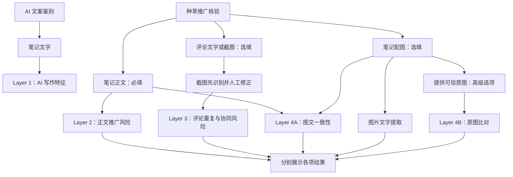

# 种草鉴别助手 · XHS Verifier

面向小红书笔记的内容分析工具：查看文案中的 AI 写作特征，检查种草分享中的推广线索。

项目提供两个入口：**AI 文案鉴别**和**种草推广核验**。你可以只分析一段文字，也可以结合笔记正文、配图和评论，分别查看值得进一步核查的线索。

> 当前为本地运行的研究 Demo，尚未提供公开在线服务。检测结果用于辅助判断，不能证明作者使用了 AI、存在商业合作，或评论账号受同一组织控制。
>
> 本版说明整理于 2026 年 10 月 13 日。后端技术与数据说明依据审阅版本 `ccd822a`；部分历史评估结果仍有待统一复核，详见下文。

## 目录

- [项目简介](#项目简介)
- [两个功能入口](#两个功能入口)
- [如何使用](#如何使用)
- [如何理解检测结果](#如何理解检测结果)
- [两个入口背后的四层分析](#两个入口背后的四层分析)
- [测试结果与评估范围](#测试结果与评估范围)
- [技术结构与本地运行](#技术结构与本地运行)
- [数据来源与模型致谢](#数据来源与模型致谢)
- [使用边界与注意事项](#使用边界与注意事项)

## 项目简介

阅读一篇种草笔记时，我们可能会产生两个不同的疑问：这段文字像不像 AI 写的？这篇分享有没有隐藏的推广线索？

种草鉴别助手将这两个问题分开处理。真人也可能撰写推广内容，AI 参与写作的文字也不一定包含广告。系统分别分析写作特征、推广表达、评论之间的相似关系，以及图片与正文或可信原图之间的关系，帮助用户找到需要进一步查看的内容。

项目没有平台后台的账号关系、交易记录或商业合作信息。它提供的是基于输入材料的分析结果，最终仍需要结合原始内容和上下文进行人工复核。

## 两个功能入口

| 入口 | 你想了解的问题 | 需要提供的材料 | 展示的分析 |
| --- | --- | --- | --- |
| **AI 文案鉴别** | 这段文案，像 AI 写的吗？ | 待检测文字 | AI 写作特征 |
| **种草推广核验** | 这篇种草，藏着推广线索吗？ | 笔记正文必填，配图和评论选填 | 正文推广风险、评论分析、图文核验，以及可选的原图比对 |

AI 文案鉴别保持轻量的文字检测流程。种草推广核验则将正文、评论和图片的分析放在同一工作区，便于一起阅读。

这些结果分别来自不同任务。系统没有将它们合成为一个“推广总分”或统一的真实性概率。

## 如何使用

### AI 文案鉴别

1. 粘贴笔记正文，或使用界面的文本导入功能。也可以通过“试用示例”了解操作方式。
2. 尽量保留原文的标点、分段和 emoji，避免只提交缺少上下文的几个词。
3. 点击“开始鉴别”，查看文字的 AI 写作特征及相关结果。

后端对少于 20 个字符的输入返回证据不足。即使达到最低长度，过短的文本也可能缺乏足够的判断线索。

该入口展示第一层的写作分析结果，不据此判断笔记是否包含推广，或商品和使用体验是否真实。

### 种草推广核验

#### 1. 输入笔记正文（必填）

粘贴需要核验的正文，尽量保留完整语境。正文用于分析潜在的推广表达；添加配图后，也会用于图文一致性分析。

#### 2. 添加笔记配图（选填）

上传与正文对应的图片，查看图片是否与文字描述大体一致，以及 OCR 提取出的图片文字。当前后端最多接收两张笔记配图，文件大小限制以当前界面提示为准。

OCR 只负责识别图片里写了什么，不会自动证明图片中的价格、功效或认证信息属实。

#### 3. 添加评论文字或截图（选填）

可以直接提供评论文字，也可以上传裁剪好的评论区截图。截图的使用流程是：

**上传截图 → 识别评论 → 检查并修改文字和分段 → 与正文一起提交分析。**

检查时应纠正错字、漏字、错误合并或拆分的评论。真实存在的重复评论应保留，因为重复情况本身也是评论分析的依据。

评论协同分析至少需要五条可用评论。数量不足时，对应结果会显示信息不足。

#### 4. 按需提供可信原图（高级选项）

在配图区展开原图比对选项，同时提供待核验图片和可信原图，进一步查看两张图片之间的差异。

可信原图应与待核验图片来自同一底图，并尽量保持一致的构图。不同角度拍摄的商品照片，通常不适合直接进行这种比较。当前实现主要统一图片尺寸后提取差异，不具备稳健的旋转、透视和裁剪对齐能力。

#### 5. 查看各项结果

先查看正文的推广风险，再阅读评论和配图分析。未提供某类材料时，该部分无法形成判断，不会因此被视为低风险。

## 如何理解检测结果

### AI 写作特征不等于 AI 使用证明

第一层判断的是整段文字是否呈现出类似训练样本中 AI 参与文本的特征。它不能确定作者身份、具体生成模型、哪些句子由 AI 写成，也不能计算 AI 写作或改写的字数比例。

即使界面显示百分比，也不能理解为“这篇文章有多少百分比由 AI 写成”。后端同时包含原始模型分数和校准后的概率估计，两者不是同一个字段。

### 推广、评论和图片结果应分别阅读

正文推广分类器只分析文字。评论和图片提供补充线索，不参与计算一个统一的推广概率。

例如，一篇笔记的正文可能出现较明显的推广表达，但评论没有足够的重复特征；另一篇笔记也可能没有明显推广表达，却出现图片与正文不对应的情况。这些组合都可能出现。

- **正文推广风险较高：**建议进一步查看推广表达、商业合作披露及上下文，不代表已经证明存在付费合作。
- **评论相似度或协同风险较高：**建议核查具体重复话术，不代表已经证明存在水军或机器人账号。
- **图文基本对应：**仅说明图片与文字的语义关系没有触发相应判断，不能证明产品功效或全部叙述真实。
- **原图比对发现差异：**需要人工查看改动位置及其影响，不能把所有修图都认定为欺骗。

`likely_non_ad` 表示模型未识别到足够明显的广告特征，不等于“确定没有广告”。

### 区分未分析、证据不足和未发现明显线索

| 状态 | 应如何理解 |
| --- | --- |
| 未提供配图、评论或可信原图 | 对应任务缺少输入，不能形成判断 |
| 文本过短或评论不足五条 | 当前材料不满足相应分析条件 |
| 分析失败或服务不可用 | 本次没有获得有效结果 |
| 暂定结果 | 当前处理方式尚缺少充分校准，不应视为确定分类 |
| 已完成分析，未发现明显风险线索 | 模型在当前材料中没有识别到明显信号，仍可能漏检 |

长文图文匹配目前存在特殊限制：系统分段比较图片与正文，并取最高匹配分数；长文模式尚未完成独立校准。因此，一个段落与图片相符，不代表整篇文字都得到图片支持。暂定结果不能当作已确认的匹配或错配。

## 两个入口背后的四层分析

“两个入口”描述用户怎样使用产品，“四层分析”描述系统分别处理哪些问题。



流程图描述用户操作与结果展示。后端当前仍使用组合分析接口，AI 文案入口只展示相应结果，并不意味着后端已经拆成只执行第一层的独立接口。

### 第一层：AI 写作特征

系统使用字符 TF-IDF 将连续字符片段转换为数值特征，再由逻辑回归分类器分析整体写作模式。项目另使用独立校准集，对基础模型的输出进行概率校准。

训练标签覆盖 AI 参与写作的情况，包括部分续写、改写和润色材料，并非只包含完全由机器生成的文章。

短文本、新网络用语、不同题材、未见过的生成模型，以及刻意调整的表达方式，都可能影响表现。

### 第二层：隐性推广语言

系统使用另一套字符 TF-IDF 和逻辑回归模型，从已标注的广告与非广告文本中学习推广表达。它与第一层拥有各自的数据、词表和分类权重。

当前分类器只使用正文文字，不直接使用评论、图片、账号历史或交易记录。实际预测入口使用的阈值为 `0.55`；测试脚本与指标记录存在需要统一的地方，见评估部分。

### 第三层：评论重复与协同风险

系统保留真实重复评论，并使用预训练的 `BAAI/bge-small-zh-v1.5` 比较评论含义。随后提取重复比例、相似评论对、整体语义聚集程度等 13 项特征，由小型分类器分析整组评论。

评论数量用于展示和最低输入条件检查，不直接作为分类器特征。这不代表评论组大小对所有统计特征都没有影响。

“链接在哪”“什么色号”等常见问题也可能自然重复。模型分析的是可见语言模式，无法核实账号之间的真实关系。

### 第四层：图文一致性与可信原图比对

**图文一致性（Layer 4A）**复用预训练的 `google/siglip2-base-patch16-224`。项目通过受控开发案例选择短文匹配阈值 `0.0278`，没有重新训练或微调 SigLIP2。该分数不是文案真实性的概率，短文阈值也不能直接视为已验证的长文阈值。

**可信原图比对（Layer 4B）**使用结构、灰度、颜色和变化区域等六项差异特征，结合小型分类器给出修改线索，保存的判断阈值为 `0.2782`。当前开发案例主要覆盖有意修改与 JPEG 重压缩对照，尚不能代表所有日常修图和平台处理方式。

图片中的 OCR 文字供人工核对，没有进一步接入一个经过训练的事实或功效核验分类器。上述功能也不构成通用的 AI 图片生成检测器。

### 团队训练了什么，复用了什么

| 组件 | 项目完成的工作 | 复用的能力 |
| --- | --- | --- |
| AI 文案鉴别 | 训练字符分类器，拟合分数校准模型 | scikit-learn 算法实现 |
| 正文推广分析 | 训练独立文本分类器，选择阈值 | scikit-learn 算法实现 |
| 评论分析 | 构建评论组特征并训练分类器 | BGE 中文语义表示 |
| 图文一致性 | 开发案例整理与阈值选择 | SigLIP2 图文表示 |
| 可信原图比对 | 提取图像差异，训练分类器并设置阈值 | OpenCV 图像处理 |
| OCR | 评论提取规则与界面校对流程 | RapidOCR 预训练识别组件 |

## 测试结果与评估范围

各模块的数据单位、标签和评估方式不同，不能相加成为“总训练量”，也不能平均得到“系统整体准确率”。界面改进和接口测试通过，也不等于模型准确率提升。

| 模块 | 评估材料与方式 | 当前可报告的结果 | 需要保留的限定 |
| --- | --- | --- | --- |
| 第一层 | 3,729 条锁定项目测试文本 | 准确率 96.49%；F1 97.52%；ROC-AUC 0.9931 | 项目内部划分上的结果，不是小红书全平台准确率，也不是上游数据集原始测试榜单成绩 |
| 第二层 | 328 条留出标注笔记 | 指标待统一复核 | 历史 README 数字与保存模型复测结果不一致，且测试脚本与实际入口阈值不同 |
| 第三层 | 291 组评论的分组五折开发验证 | 准确率 90.72%；F1 86.29% | 包含团队构造正例，阈值也参考了这批开发结果，不是独立真实协同事件测试 |
| 第四层 A | 60 个受控短文图文案例 | 历史五折开发准确率 93.33% | 历史折分与专用评估脚本未完整保存在审阅版本中；不代表长文或全新真实笔记的表现 |
| 第四层 B | 25 个来源案例衍生的 50 组比较 | 保存阈值为 0.2782；尚无独立测试指标 | 同一来源的修改图与 JPEG 对照一起分组；阈值选择使用了开发结果 |

### 第一层的数据划分

| 数据阶段或用途 | 文本数量 |
| --- | ---: |
| 筛选后、去重前 | 19,667 |
| 去重后保留 | 18,668 |
| 基础分类器训练 | 9,336 |
| 开发集 | 2,803 |
| 概率校准集 | 2,800 |
| 锁定测试集 | 3,729 |

前两行表示处理阶段，后四行是去重后数据的划分，不能把整张表相加。近似文本按组划分，以减少相似内容同时进入训练与测试的情况。

### 第二层的指标为何暂不定稿

历史 README 记录准确率 87.2%、F1 63.8%。后端审阅说明指出：实际预测入口采用 `0.55`，测试脚本采用 `0.50`；在同一批 328 条测试笔记上的保存模型复测如下。

| 使用的阈值 | 复测准确率 | 复测 F1 |
| --- | ---: | ---: |
| 0.50 | 84.76% | 63.77% |
| 0.55 | 86.59% | 62.71% |

复测加载模型的 scikit-learn 版本与保存模型时记录的版本不同，因此这些数字用于说明现有差异，暂不作为重新确认的正式成绩。应在兼容环境中，使用统一的实际运行阈值复测，并保存命令、依赖版本与混淆矩阵。不能根据测试集结果重新挑选更有利的阈值。

### 评论与图片数据的范围

- 第三层开发数据包含 191 组人工筛选的负例和 100 组团队构造的正例，共 4,723 条评论。它们不代表 291 起已查实的真实协同事件。
- 另有 30 组来自 Kaggle 评论资源的暂定负例记录，不属于上述 291 组训练数据；此处不声明其已完成独立评估。
- 第四层 A 使用 60 个短文图文案例选择阈值。开发集上选阈值后的表现不能代替独立测试。
- 第四层 B 的 50 组比较来自 25 个原图案例，每个案例产生一组有意修改比较和一组 JPEG 重压缩对照，不能称为 50 个独立场景。
- 原图比对在所选阈值下对这批开发结果的完全分离，不代表对未知图片具有 100% 准确率。

第四层另有 30 个全新案例的独立测试计划：20 个图文案例（10 个匹配、10 个错配），以及 10 组原图比较（5 组正常或未修改、5 组有意修改）。这仍是采集和评估目标，不能写成已完成结果。标签应在运行前确定，不能复用开发图片或根据测试结果修改阈值。

**指标速读：**准确率表示整体判对的比例；精确率表示被标记样本中有多少符合目标标签；召回率表示实际目标样本中找出了多少；F1 综合精确率与召回率；ROC-AUC 描述分数的排序能力。交叉验证结果与最终独立测试结果应分别报告。

## 技术结构与本地运行

### 技术结构

- **前端：**Next.js、React、TypeScript，负责收集材料、校对 OCR 结果和展示报告。
- **后端：**Python FastAPI，加载保存的模型与配置，处理文字、评论和图片。
- **数据与训练脚本：**负责数据整理、特征提取、分类器训练、分数校准与评估。

日常分析使用已保存的模型。点击分析不会重新训练模型，也不会自动把输入加入训练集。运行 Demo 通常不需要先执行全部训练脚本，但需要具备对应的模型文件和运行依赖。

大型 Python 模型由后端运行，不在浏览器中执行。前端启动成功不代表后端模型已全部就绪。

### 启动后端

先准备 Git、Python 和 Node.js/npm。具体依赖请查看 `backend/requirements.txt` 与 `frontend/package.json`，模型文件应与代码及依赖环境相容。

```bash
git clone https://github.com/jiaweiz5/projectdounai.git
cd projectdounai/backend
```

Windows PowerShell：

```powershell
python -m venv .venv
.\.venv\Scripts\Activate.ps1
python -m pip install -r requirements.txt
python -m uvicorn main:app --reload --port 8000
```

macOS / Linux：

```bash
python3 -m venv .venv
source .venv/bin/activate
python -m pip install -r requirements.txt
python -m uvicorn main:app --reload --port 8000
```

首次运行部分功能可能需要下载预训练模型，请预留磁盘空间和下载时间。已保存的分类器位于 `backend/models/`，相关配置及部分缓存位于 `backend/data/`；缺少相应文件时，相关分析可能不可用。

### 启动前端

另开一个终端，进入所克隆仓库的 `frontend` 目录：

```bash
npm install
npm run dev
```

如需指定后端地址，在 `frontend/.env.local` 中设置：

```ini
BACKEND_URL=http://127.0.0.1:8000
```

修改环境配置后重启前端。启动完成后，在运行服务的电脑上访问：

- 前端：[http://localhost:3000](http://localhost:3000)
- 后端接口文档：[http://localhost:8000/docs](http://localhost:8000/docs)
- 后端健康检查：[http://localhost:8000/health](http://localhost:8000/health)

这些是本地地址，不是公开部署链接。健康检查响应也不等于每个模型都已完成加载或测试。

### 主要接口

| 接口 | 作用 |
| --- | --- |
| `GET /health` | 查看服务状态 |
| `POST /analyze` | 接收正文及可选评论、配图，返回各项分析 |
| `POST /analyze-screenshot` | 提取评论截图文字，并执行评论分析 |
| `POST /analyze-layer4-reference` | 比较待核验图片与可信原图 |

以运行版本的 `/docs` 为准核对请求字段。截图接口可以返回评论分析，但用户最终提交前仍应检查并修正识别文字。

### 可选的 Qwen 报告

后端支持调用外部 Qwen 服务，将检测结果整理为文字说明。Qwen 不负责计算上述检测分数，项目也没有训练或微调 Qwen。审阅版本中的前端默认发送 `include_report: false`，直接展示各项检测结果。

若主动启用报告功能，需要配置 `QWEN_BASE_URL`、`QWEN_API_KEY` 和 `QWEN_MODEL`。这一路径会向所配置的服务发送部分笔记正文及选定的检测信息；请在启用前确认数据处理要求。密钥应保存在本地环境配置中，不要提交到仓库。

### 验证与排查

在 `frontend` 目录运行 `npm run build` 可以检查前端生产构建，但不能验证模型准确率。

如果分析失败，先检查后端是否启动、前端代理地址是否正确，以及对应模型和配置文件是否存在。更新模型文件后，应重启后端进程以加载新版本。

复现评估与重新训练是不同任务。训练脚本可能覆盖模型、缓存或数据划分，应在单独的实验副本中执行。重新训练前需保存数据版本、环境和原有评估记录。

## 数据来源与模型致谢

感谢开源数据集、模型和工具的作者。以下来源承担不同用途，不能把上游资源的全部规模视为本项目的训练数量。

| 来源或工具 | 本项目中的用途 |
| --- | --- |
| RedNote-Vibe | 第一层的人类与 AI 文本来源之一 |
| `AnxForever/chinese-ai-detection-dataset` | 第一层另一文本来源，包含 AI 参与、续写、改写等材料 |
| HC3、THUCNews 等上游来源 | 部分材料通过 AnxForever 间接进入，已经包含在本项目数据统计内 |
| CHASM | 第二层广告标签与文本来源，也提供第三层部分评论素材 |
| `BAAI/bge-small-zh-v1.5` | 第三层评论语义表示，未在本项目中微调 |
| `google/siglip2-base-patch16-224` | 第四层图文表示，未在本项目中微调 |
| RapidOCR | 评论截图与笔记配图的文字识别 |
| scikit-learn、OpenCV 及相关开源依赖 | 分类器训练、校准、图像处理与运行支持 |
| 团队自建与审核数据 | 协同式评论、图文案例、修改图片和对照样本 |

CHASM 的广告标签不能直接当作评论协同标签。第三层评论标签来自单独的筛选和构造流程；团队构造正例也不能视作已调查确认的真实事件。

团队的工作包括数据筛选与审核、样本构造、特征设计、分类器训练、校准与评估，以及 API、OCR 流程和前端整合。使用预训练模型不代表拥有其原始训练成果，也不代表数据或模型作者为本项目背书。

使用或再发布相关数据和图片前，请分别核对原始来源、授权条款与平台要求。开源代码的可用性不自动代表全部数据和媒体都可以任意再分发。

## 使用边界与注意事项

- 本项目分析用户提供的材料，不能核实账号控制关系、商业付款、购买记录或作者真实意图。
- 项目测试表现不能直接推广到全部小红书内容。题材、语言风格、生成模型和图像处理方式变化后，表现可能改变。
- 没有明显风险信号不等于已经证明内容真实；未分析、证据不足和分析失败也不等于低风险。
- 图文一致不能证明商品功效；图文不一致不能证明图片由 AI 生成。
- 原图必须来源可信且与待核验图对应。裁剪、位移、滤镜和压缩等正常处理也可能触发差异。
- 不应公开数据中的用户 ID、头像、联系方式或无关个人信息。对截图进行分享或公开展示前，应处理不必要的个人信息。
- 高风险提示应引导人工查看具体依据，不应直接给创作者、评论者或品牌作出欺骗、刷量或违法定性。
